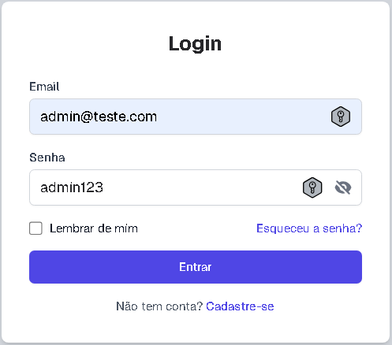

# Login Screen

Projeto de aprendizado com React, Next.js e Tailwind CSS para praticar componentes, formulários, validação de campos e navegação entre páginas.

**A autenticação é simulada e não é segura para produção.** Os usuários de teste ficam no código e a sessão é representada por dados no `localStorage` do navegador. Não há back-end, banco de dados ou proteção real de rotas.

## Demo

[login-screen-react-mauve.vercel.app](https://login-screen-react-mauve.vercel.app/)

## Preview



## Funcionalidades

- Tela de login responsiva na rota `/`, com campos de e-mail e senha.
- Validação de campos obrigatórios, formato de e-mail e credenciais de teste.
- Mensagens de erro no formulário.
- Botão para exibir ou ocultar a senha.
- Login simulado com redirecionamento para `/user-screen`.
- Página de usuário com nome, e-mail e uma data de criação fixa, apenas demonstrativa.
- Retorno ao login quando os dados de usuário estão ausentes ou não podem ser interpretados como JSON.
- Logout que remove os dados de usuário do `localStorage` e retorna ao login.

## Credenciais de teste

```txt
E-mail: admin@teste.com
Senha: admin123
```

Os usuários de demonstração estão em `lib/Data-storage/user-storage.ts`. As credenciais são públicas e servem apenas para testar o fluxo simulado.

## Tecnologias

- Next.js 16 com App Router.
- React 18.
- TypeScript 5.
- Tailwind CSS 3 e PostCSS 8.
- React Icons 5.
- ESLint 9.

O script de build utiliza Webpack (`next build --webpack`). O desenvolvimento mantém o comando `next dev`.

## Como executar localmente

Com Node.js e npm instalados:

```bash
git clone https://github.com/SaunKiziN/Login-Screen-REACT.git
cd Login-Screen-REACT
npm ci
npm run dev
```

Acesse [localhost:3000](http://localhost:3000).

Para gerar e executar o build localmente:

```bash
npm run build
npm start
```

As fontes Geist e Geist Mono são carregadas com `next/font/google`; o build precisa de acesso ao Google Fonts para baixá-las.

## Verificações

```bash
npm run lint
npx tsc --noEmit
npm run build
npm audit --omit=dev
```

## Estrutura principal

```txt
app/
├── login-screen/
│   └── login.tsx
├── user-screen/
│   └── page.tsx
├── favicon.ico
├── globals.css
├── layout.tsx
└── page.tsx
lib/
├── Data-storage/
│   └── user-storage.ts
└── validation.ts
public/
└── preview.png
LICENSE
README.md
```

## Limitações

A validação ocorre no navegador, usando uma lista local de usuários. Os dados no `localStorage` podem ser alterados pelo visitante; a checagem na página de usuário serve somente para demonstrar a navegação.

Não há cadastro, recuperação de senha ou opção “Lembrar de mim”. A persistência existente usa `localStorage` até o logout ou a remoção dos dados do navegador. Este projeto não deve ser usado como sistema de autenticação em produção.

## Autor

Samuel Berretta / SaunKiziN

- GitHub: [github.com/SaunKiziN](https://github.com/SaunKiziN)
- LinkedIn: [linkedin.com/in/samuel-berretta](https://www.linkedin.com/in/samuel-berretta)
- E-mail: [samuberretta.biz@gmail.com](mailto:samuberretta.biz@gmail.com)

## Licença

Licença [MIT](./LICENSE). Copyright (c) 2025 Samuel Berretta.
